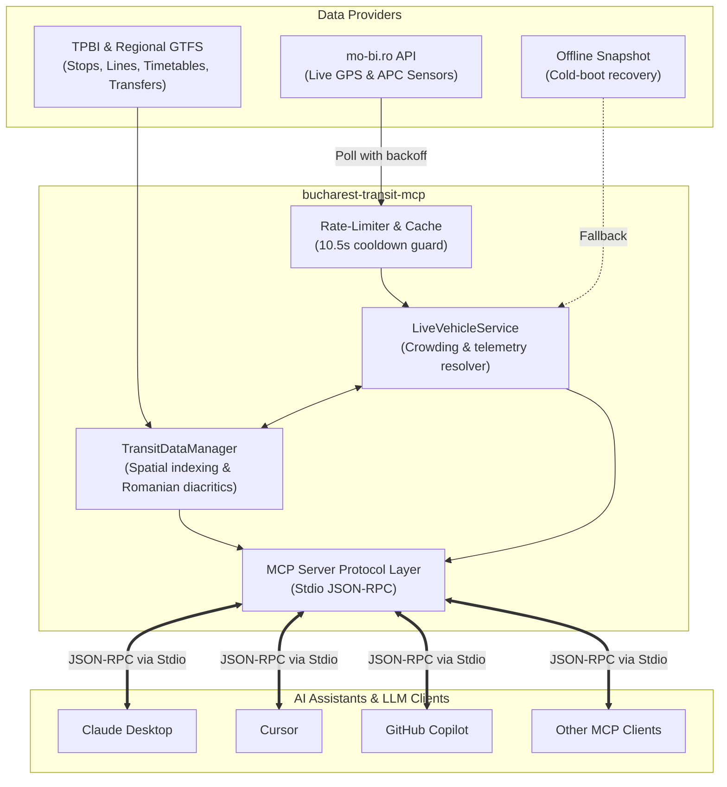

# Bucharest Transit MCP Server 🚌🚊🚇

[](LICENSE)
[](https://nodejs.org/)
[](https://www.typescriptlang.org/)
[](https://modelcontextprotocol.io/)
[](#-development--testing)

A production-grade **Model Context Protocol (MCP)** server providing real-time telemetry, live vehicle tracking, GTFS timetables, arrival countdowns, spatial stop search, multimodal transfers, and transit agencies for the metropolitan transit network of **Bucharest and Ilfov County, Romania** (STB SA, TPBI, Metrorex, STV, STCM, Regio Serv).

Derived from the reverse-engineered telemetry engine of the native iOS app [BucharestTransit](https://github.com/therosaer/BucharestTransit) by [`@therosaer`](https://github.com/therosaer) and enriched with official TPBI regional GTFS data.

---

## ⚡ Quick Start

You can run the server directly with `npx` (no cloning required):

```bash
npx -y bucharest-transit-mcp
```

Or connect it to your favourite MCP client (Claude Desktop, Cursor, GitHub Copilot, Roo Code, LibreChat, etc.) using the [configuration guides below](#-client-configuration).

---

## 🏗️ Architecture & Data Flow



---

## ✨ Features

- **📡 Live Fleet Telemetry (`mo-bi.ro`)**: Real-time GPS coordinates, speed, bearing, route IDs, license plates, and direction for thousands of active buses, trams, trolleybuses, regional buses, and night buses.
- **👥 Automatic Passenger Counting (APC)**: Real-time sensor telemetry detailing current headcount (`on_board`, `in`, `out`) and standardized crowdedness levels (`empty`, `low`, `moderate`, `high`, `crowded`).
- **📅 380+ Complete Line Timetables**: Full weekday (`schedule_wd`) and weekend (`schedule_we`) departure timetables across the entire network, dynamically evaluated in the `Europe/Bucharest` timezone.
- **⏱️ Live Arrival Countdowns**: Real-time arrival estimates ("Pleacă acum", "în 4 min (la 14:25)").
- **📍 Spatial Stop Search & Geocoding**: Search 4,500+ regional stops and stations with Romanian diacritic normalization (e.g. `Piata Romana` matches `Piața Romană`), retrieve physical street addresses (`Drumul Binelui, Bucuresti`), or query nearby stops within a given radius using the Haversine formula.
- **🔀 Multimodal Transfers & Metro Connections**: Find interchange points between surface lines and Metrorex underground subway stations.
- **🧭 Direct Route Planning**: Find transit lines directly connecting any two stations without transfers.
- **🛡️ Built-in Rate Limiting & Resilience**: Enforces a strict 10.5-second cooldown to respect upstream telemetry infrastructure, with automatic offline fallback to bundled snapshot data.

---

## 🛠️ MCP Tools

| Tool | Parameters | Description |
| :--- | :--- | :--- |
| `get_live_vehicles` | `line?`, `mode?`, `crowded_only?`, `limit?`, `force_refresh?` | Real-time vehicle positions, license plates, velocities, and crowding levels. Modes: `all`, `bus`, `tram`, `trolley`, `regional`, `night`, `metro`. |
| `get_vehicle_by_id` | `vehicle_id` | Inspect an individual vehicle by ID (e.g. `1885`, `stb-1885`) or license plate (e.g. `B-327-STB`). |
| `get_fleet_stats` | `mode?` | Network-wide operational snapshot: active vehicles, average speed, mode breakdown, and passenger crowding. |
| `list_lines` | `type?`, `query?` | Directory of transit lines with route colors, operators, and terminal endpoints. |
| `get_line_details` | `line_name` | Complete itinerary (Tur/Retur stop sequences, geometries, and serving vehicles). |
| `get_station_schedule` | `line_name`, `station_query`, `direction?`, `limit?` | Upcoming departure countdowns and full daily timetable for a station. |
| `search_stations` | `query`, `limit?` | Diacritic-tolerant search across 4,500+ stops returning codes, street descriptions, and lines served. |
| `find_nearby_stops` | `latitude`, `longitude`, `radius_meters?`, `limit?` | Spatial proximity search for transit stops around coordinates. |
| `plan_direct_route` | `from_station`, `to_station` | Finds direct transit lines between two stations with intermediate stop details. |
| `get_transit_agencies` | *(none)* | Directory of certified regional transit authorities (STB SA, METROREX, STV SA, STCM, Regio Serv). |
| `get_station_transfers` | `station_name_or_id` | Multimodal transfer points and connections for a given station. |

---

## 📦 MCP Resources & Prompts

### Resources
- `bucharest://transit/stats` — Real-time operational snapshot of active vehicles and system load.
- `bucharest://transit/lines` — Complete directory of all transit lines with modes, colors, and terminals.
- `bucharest://transit/agencies` — Directory of official Bucharest-Ilfov transport operators.

### Prompts
- `next_departure` — Context-aware assistance for finding upcoming departures at any station.
- `route_advice` — Direct routing and navigation guidance between two Bucharest locations.

---

## 💬 Example User Prompts

Once connected to your LLM, try asking:

- *"When is the next 241 bus arriving on Tur at station Aurel Persu?"*
- *"Are the trams on line 1 or 41 crowded right now?"*
- *"Find all public transit stops within 500 meters of Piața Unirii."*
- *"Can I get from Piața Romană to Universitate directly without changing buses?"*
- *"Show me an overview of all active public transit vehicles in Bucharest right now."*
- *"Where does bus 100 stop on its way to Henri Coandă Airport (Otopeni)?"*

---

## 💻 Client Configuration

### Claude Desktop

Edit your `claude_desktop_config.json`:
- **macOS**: `~/Library/Application Support/Claude/claude_desktop_config.json`
- **Windows**: `%APPDATA%\Claude\claude_desktop_config.json`
- **Linux**: `~/.config/Claude/claude_desktop_config.json`

```json
{
  "mcpServers": {
    "bucharest-transit": {
      "command": "npx",
      "args": ["-y", "bucharest-transit-mcp"]
    }
  }
}
```

*Or with local source:*
```json
{
  "mcpServers": {
    "bucharest-transit": {
      "command": "node",
      "args": ["/path/to/bucharest-transit-mcp/dist/index.js"]
    }
  }
}
```

### Cursor (`.cursor/mcp.json`)

```json
{
  "mcpServers": {
    "bucharest-transit": {
      "command": "npx",
      "args": ["-y", "bucharest-transit-mcp"]
    }
  }
}
```

### VS Code / GitHub Copilot (`settings.json`)

```json
{
  "github.copilot.chat.mcp.servers": {
    "bucharest-transit": {
      "command": "npx",
      "args": ["-y", "bucharest-transit-mcp"]
    }
  }
}
```

### Claude Code CLI

```bash
claude mcp add bucharest-transit npx -y bucharest-transit-mcp
```

---

## 🔧 Environment Variables (Optional)

| Variable | Description | Default |
| :--- | :--- | :--- |
| `BUCHAREST_TRANSIT_DATA_DIR` | Custom path to folder containing `routes_map.json`, `line_routes_index.json`, `snapshot_vehicles.json`, and `gtfs/`. | Bundled `data/` directory |

---

## 🧪 Development & Testing

```bash
# Clone the repository
git clone https://github.com/therosaer/BucharestTransitMCP.git
cd BucharestTransitMCP

# Install dependencies
npm install

# Run the test suite (17 unit and integration tests)
npm test

# Build TypeScript to dist/
npm run build

# Start the server locally on stdio
npm start
```

---

## 📚 Data Attribution & Upstream Services

- **Live Telemetry Feed**: `https://mo-bi.ro/python_api/` (Public Open Data transport feed).
- **Static Timetables & Regional GTFS**: Derived from official TPBI (Asociația de Dezvoltare Intercomunitară pentru Transport Public București - Ilfov) and regional operators.
- **Reference Application**: [BucharestTransit](https://github.com/therosaer/BucharestTransit) by [`@therosaer`](https://github.com/therosaer).

*This project is an independent open-source contribution and is not officially affiliated with or endorsed by STB SA, TPBI, or Metrorex.*

---

## 📄 License

[MIT](LICENSE) © therosaer
